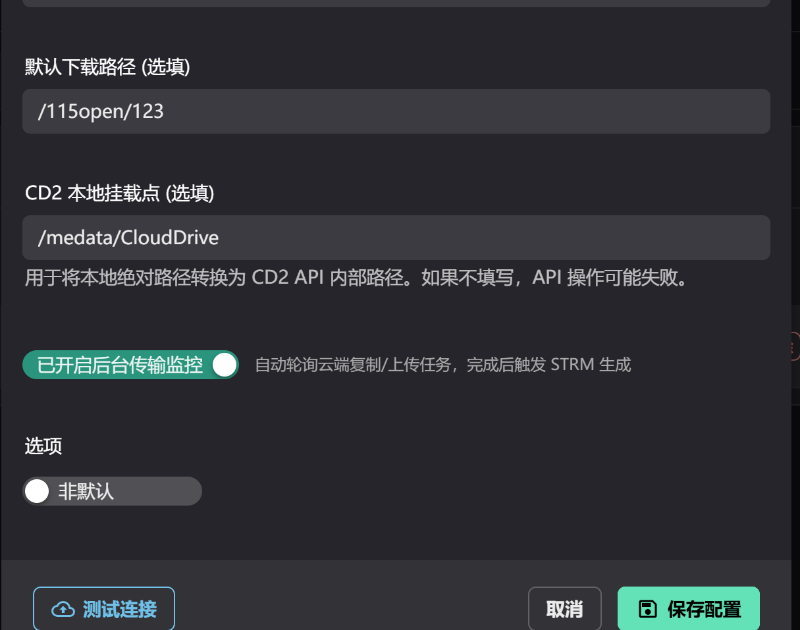
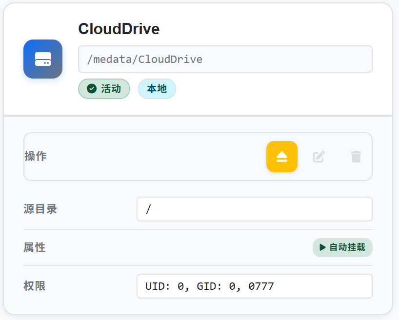
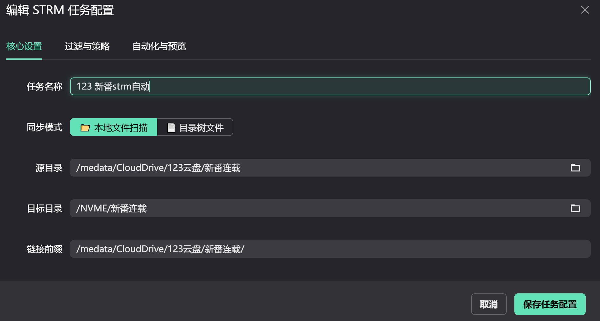
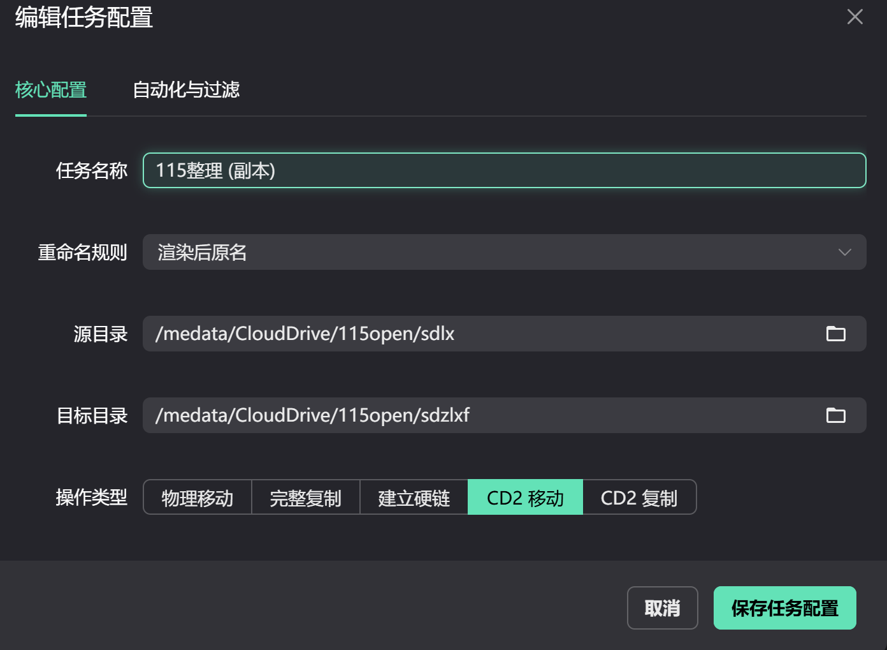

# 设置说明

系统设置入口为侧边栏的 **[系统设置]** 页面，包含六个标签页：

| 标签页 | 内容 |
|--------|------|
| **基础配置** | TMDB / Bangumi / SYTMDB / 识别偏好 / Jackett / Emby / Telegram 通知 / 代理 / 磁盘空间回收规则 |
| **下载器管理** | 下载客户端（qBittorrent / CloudDrive2）的添加、编辑、删除、测试 |
| **识别与订阅规则** | 自定义识别词 / 制作组 / 渲染词 / 特权规则（本地 + 远程订阅） |
| **账号与安全** | 密码修改、2FA、会话管理 |
| **服务状态** | 系统服务、文件监控任务、运行时统计、规则统计 |
| **掉盘与失效检测** | 硬盘掉线 / CD2 可达性 / Cookie 失效的定时巡检配置 |

> 定时任务相关设置（RSS 刷新、规则同步、订阅补全、死种清理、磁盘空间回收的启用开关与巡检周期等）已迁移至 **[任务计划]** 页统一管理。AI 助手相关设置在独立的 **[AI 实验室]** 页面；外观与壁纸在顶栏的主题菜单中配置（见文末）。

---

## 一、基础配置

### TMDB 设置

| 配置项 | 说明 |
|--------|------|
| TMDB API Key | 从 https://www.themoviedb.org/settings/api 申请 |
| 图片域名 | 可替换为国内镜像站加速图片加载 |
| 启用图片代理 | 开启后通过网络设置中配置的代理访问图片域名；使用国内镜像站时建议关闭，直连更快 |

### Bangumi 设置

| 配置项 | 说明 |
|--------|------|
| BGM Token | 从 https://next.bgm.tv/demo/access-token 获取 |

### SYTMDB 设置

作者的另一个项目，用于同步修正后的元数据，非必要无需填写。

| 配置项 | 说明 |
|--------|------|
| 服务地址 | SYTMDB 服务地址，用于同步修正后的元数据 |
| API Token | 如果 SYTMDB 服务配置了认证，请填写 Token |

### 识别偏好设置

| 开关 | 说明 |
|------|------|
| 动漫识别优化 | 提升动画匹配精度，过滤同名真人剧 |
| 标题分词搜索 | 匹配失败时将标题切分为单词重试；建议保持关闭 |
| 本地数据中心优先 | 优先碰撞本地数据库，实现毫秒级离线匹配 |
| 合集识别增强 | 支持解析 01-12 等合集，自动计算集数区间 |
| Bangumi 数据源优先 | 针对新番或缺失条目，优先尝试 BGM 镜像 |
| Bangumi 故障转移 | TMDB 匹配失败时自动使用 BGM 补全（开启「Bangumi 数据源优先」时不可用） |
| 智能记忆 | 自动记住系列特征，后续文件实现秒级识别 |

### Jackett 设置

| 配置项 | 说明 |
|--------|------|
| Jackett URL | 如 `http://192.168.50.12:9117/`（请确保包含端口号） |
| API Key | Jackett 的 API Key |
| 管理密码 | 如果你的 Jackett 设置了访问密码，请在此填写以获取完整站点列表 |

### Emby 设置

| 配置项 | 说明 |
|--------|------|
| 服务地址 | Emby 服务器地址，包含端口号（如 `http://localhost:8096`） |
| API Key | 在 Emby 设置中生成 API Key |
| 用户名 / 密码 | Emby 登录账号 |
| 用户 ID | 在 Emby 用户配置页面，从浏览器地址栏复制 userId 参数值 |

### 通知设置 (Telegram)

| 配置项 | 说明 |
|--------|------|
| Bot Token | 从 @BotFather 获取，用于发送消息 |
| Chat ID | 发送消息给 @userinfobot 获取个人 Chat ID，群组/频道通常以 -100 开头 |
| 通知类型 | 系统启动 / 新增订阅 / 删除订阅 / 订阅完结 / 订阅推送 / 规则下载 / 整理完成 / STRM 完成 / STRM 联动 |
| 发送测试消息 | 填写 Bot Token 后可发送测试消息验证连通性 |

### 网络代理设置

| 配置项 | 说明 |
|--------|------|
| HTTP 代理 | 支持 `http://ip:port` 或 `http://user:pass@ip:port` |
| 代理服务 | 勾选走代理的服务：TMDB / Bangumi / 远程规则 / Docker Hub / Jackett / Telegram / RSS 订阅 |

### 磁盘空间回收规则

监控 QB 种子占用体积，超过阈值后从最老的种子开始删除。回收功能的**启用开关与巡检周期**请在「任务计划」页的「磁盘空间自动回收」卡片中管理，此处仅配置回收规则。

每条规则包含：

| 配置项 | 说明 |
|--------|------|
| 指定下载器 | 不选则对所有 QB 生效 |
| 监控路径 | 如 `/downloads` |
| 体积上限 (GB) | 超过上限即触发回收 |
| 最少做种数保护 (0=不保护) | 做种数低于该值的种子不删除 |
| 保护标签 (逗号分隔) | 带有这些标签的种子不删除，如 `keep,important` |

规则支持「预览」（查看各组占用与计划删除清单）和「执行」（立即回收）。

---

## 二、下载器管理

在 **[系统设置] → [下载器管理]** 中添加、编辑、删除下载客户端，保存前可「测试连接」。

支持的客户端类型：**qBittorrent** 与 **CloudDrive2**（CD2 客户端仅可添加一个）。

通用配置项：

| 配置项 | 说明 |
|--------|------|
| 类型 | qBittorrent / CloudDrive2 |
| 名称 | 给它起个名字 |
| 地址 (URL) | 如 `http://192.168.1.x:8080` |
| 用户名 / 密码 | 下载器登录凭据 |
| API Token / API Key (选填) | QB 5.2.0+ 可用（填写后无需账号密码）；CD2 填写后直接使用 API Token 认证 |
| 默认下载路径 (选填) | 留空则使用下载器全局设置 |
| 设为默认客户端 | 开启后作为新增下载任务的默认下载器 |

### CD2 (CloudDrive2) 设置教程

#### 1. CD2 下载器配置（gRPC 连接）

番剧管家通过 CloudDrive2 的 **gRPC 接口** 与 CD2 深度集成。在 **[系统设置] → [下载器管理]** 中添加类型为 **CloudDrive2** 的下载器：

| 配置项 | 说明 |
|--------|------|
| 地址 (URL) | CD2 的访问地址，如 `http://192.168.50.12:19798` |
| 用户名 / 密码 | CD2 登录凭据 |
| API Token (选填) | 填写后直接使用 API Token 认证，无需用户名密码 |
| 默认下载路径 (选填) | CD2 云盘路径（如 `/115open/downloads`），作为订阅/下载的默认落点 |
| CD2 本地挂载点 (选填) | 本地挂载视图路径（如 `/medata/CloudDrive`），用于云路径 ↔ 本地路径自动换算；gRPC 免挂载场景选填，本地扫描/Webhook 匹配场景建议填写 |
| 后台传输监控 | 开启后轮询 CD2 传输任务状态，完成后自动触发 STRM 生成与通知 |
| 监控间隔 (秒) | 传输监控的轮询周期 |



#### 2. 免挂载 gRPC 能力

配置好 CD2 下载器后，以下功能全部通过 gRPC 接口完成，**无需将网盘挂载到本地**：

*   **STRM 免挂载同步**：STRM 任务「同步模式」选择 **CD2 云盘 (gRPC)**，源目录直接填云路径（详见「使用指南 → 虚拟库 (STRM)」）
*   **免挂载云整理**：整理任务源/目标目录类型选择「CD2 云盘」：云 → 云走服务器端移动/复制，云 → 本地走 CD2 下载接口直接下载，本地 → 云走 Remote Upload 上传
*   **云端单文件识别**：在 CD2 管理中心「文件浏览」中可直接对云端文件识别并整理式重命名
*   **云端哈希计算**：通过 CD2 API 流式取流计算 SHA1/ED2K，无需落盘
*   **离线下载管理**：磁力/种子推送到网盘离线下载，任务列表/配额/删除管理
*   **CD2 管理中心**：[CD2] 页面的文件浏览、传输监控、深度删除、协议管理（gRPC proto 自动下载编译）

#### 3. CD2 容器挂载配置（按需）

以下场景仍需要将 CD2 挂载到本地，并正确配置容器挂载传播：

*   STRM / 整理任务使用「本地文件扫描」模式读取挂载目录中的文件
*   Emby / Jellyfin 等播放器需要直接读取挂载路径中的媒体文件播放
*   Webhook 联动「本地文件扫描」模式的 STRM 任务（需要按挂载点换算路径）

##### CloudDrive2 容器挂载配置

在使用CloudDrive2（CD2）时，需要正确配置容器挂载，以确保其他容器能够访问CD2挂载的网盘文件。

##### Docker Compose 配置

在CD2的docker-compose.yml中，需要添加两条挂载规则：

```yaml
volumes:
  # 第一条：给CD2的compose使用（shared模式）
  - /vol1/1000/NVME/docker2/clouddrive2-19798/medata:/medata:shared

  # 第二条：其他需要挂载CD2的容器使用（rslave模式）
  - /vol1/1000/NVME/docker2/clouddrive2-19798/medata:/medata:rslave
```

##### 挂载模式说明

- **shared**：CD2容器自身使用，允许挂载传播
- **rslave**：其他容器使用，只接收挂载传播

##### CD2挂载设置示例



#### 4. STRM虚拟库配置

在STRM虚拟库中配置网盘文件路径。



#### 5. 整理任务网盘设置

配置整理任务中的网盘路径映射。



---

## 三、识别与订阅规则

**[系统设置] → [识别与订阅规则]** 包含四组规则卡片，每组均分左右两栏：

*   **本地规则**（可编辑）：每行一条，即时生效
*   **远程订阅**（仅同步）：填写规则 txt 的 URL，每行一个，通过右上角「同步远程规则」按钮拉取

| 规则卡片 | 格式示例 |
|---------|---------|
| 自定义识别词 | `10月新番`（屏蔽词）；或 `藤本树 17-26 => 藤本树 17_26`（替换） |
| 自定义制作组 | `SweetSub`、`Mikanani`（每行一个制作组名） |
| 自定义渲染词 | `剧场版 => {[type=movie]}`、`S2 => {[s=2]}` |
| 自定义特权规则 | `正则表达式 => {[字段=值;字段=值]}`，如 `^\[([^\]]+)\]\s+(.+?)\s+-\s+(\d{1,4}) => {[group=\1;title=\2;e=\3]}`；加 `ai=1` 字段可使命中文件直接交给 AI 识别（如 `\[晚街與燈\] => {[group=晚街與燈;ai=1]}`） |

各规则类型的详细语法说明见「识别规则」「渲染词」「特权规则」专篇文档。

---

## 四、账号与安全

### 凭据管理

填写当前密码、新密码、确认新密码后点击「立即更新密码」。

### 多重身份验证 (2FA)

TOTP 动态验证码开关。开启后展示二维码与密钥，使用验证器应用扫码并输入 6 位验证码确认；每次登录时系统都会要求提供动态码。未开启时页面会提示高风险警告。

### 会话管理

*   **JWT 令牌永不过期**：开启后登录令牌将不会自动过期（10 年），关闭后为 24 小时自动过期。永不过期会降低安全性，建议仅在可信环境中使用
*   **会话列表**：展示每个会话的浏览器 / 系统、IP、登录时间与过期时间，当前会话有标记；可单独「踢出」某个会话，或「踢出所有其他设备」
*   **退出登录**：页面底部显示当前登录用户名与最近登录时间，可退出登录

---

## 五、服务状态

只读监控页，右上角可开关「自动刷新」（约 3 秒轮询一次）：

*   **系统服务**：各内置服务的运行状态、执行间隔、下次执行 / 上次同步时间与描述
*   **文件监控任务**：整理 / STRM 监控的运行状态、模式（含「接受联动」「Emby检查」「哈希计算」标记）、源目录与目标；运行中的任务显示待处理队列数量，点击「查看队列」可实时查看排队文件（首条标记为正在处理）
*   **运行时统计**：文件观察器 / 工作线程 / 任务队列数量
*   **规则统计**：自定义识别词、自定义制作组（本地 / 远程 / 内置）、自定义渲染词、特权规则的条数统计

---

## 六、掉盘与失效检测

通过定时检测指定文件是否存在，用于监测本地硬盘是否掉线、CD2 云端是否可访问，或下载源的 Cookie 是否失效。

### 全局设置

| 配置项 | 说明 |
|--------|------|
| 自动巡检 | 定时检测硬盘掉线和 Cookie 失效 |
| 巡检频率 (分) | 巡检间隔（分钟） |
| 立即检测全部 | 手动触发所有配置的检测 |

### 检测配置

| 配置项 | 说明 |
|--------|------|
| 配置名称 | 如「阿里云盘掉盘检测」 |
| 文件路径类型 | **本地路径**（文件存在 + IO 读取验证）或 **CD2 云盘**（gRPC 云端文件存在性检查，路径如 `/115open/check.txt`） |
| 文件路径 | 待检测的文件，可从文件浏览器选择 |
| 远程 URL | 文件的直链 URL（包含 Cookie 或 Token） |
| 启用检测 | 关闭后不参与巡检 |

**判定逻辑**：仅填写文件路径 → 只检测文件是否存在；同时填写远程 URL → 文件存在后再请求 URL，HTTP 非 200/206 则判定 Cookie 失效。状态标签显示为 正常 / 异常 / 未检测。

---

## 七、AI 实验室（独立页面）

**[AI 实验室]** 页面包含六个标签页：**AI 对话**、**工具列表**、**技能管理**、**助手配置**、**AI 介入测试**、**Telegram Bot**。

### 助手配置

**AI 模型配置：**

| 配置项 | 说明 |
|--------|------|
| 模型提供商 | Ollama (本地) 或 OpenAI / 兼容接口 |
| API 地址 | Ollama 默认 `http://localhost:11434`，OpenAI 兼容接口填完整 v1 地址 |
| API Key | 仅 OpenAI 兼容接口需要 |
| 模型名称 | 如 `qwen2.5:7b` 或 `gpt-4o`，可点击「拉取列表」从 API 读取可用模型直接选 |

**推理参数：**

| 配置项 | 说明 |
|--------|------|
| 温度 | 0 - 2，控制输出随机性 |
| 思考深度 | 跟随服务端默认（auto）/ 关闭（off）/ 最低（minimal）/ 低 / 中 / 高 / 最高（max）/ 极高（xhigh）；「探测能力」会确认该模型用哪种参数能关掉思考并缓存复用 |
| 最大输出 Token 数 (K) | 发给模型的单轮输出上限，单位千（64 → 64000），不是会话记忆上限 |
| 历史条数上限 / 历史 Token 预算 | 会话记忆的双上限：超出先把最旧消息压成摘要，再超就硬截断（Token 预算填 0 表示只按条数限制） |
| 最大迭代次数 | 单次对话允许的工具调用轮数上限 |
| 允许 AI 操作（工具调用） | 开启后 AI 可调用搜索、订阅、整理等工具执行实际操作；关闭仅能聊天问答。Telegram Bot 未单独设置时也使用该全局默认值 |
| 动态工具选择 | 开启：按消息内容自动挑选相关工具（省 token）；关闭：把全部工具提供给模型（更稳但更耗 token） |
| AI 智能介入 | **全局兜底**：常规识别全部失败后让 AI 猜测标题并重新搜索。此外特权规则命中 `ai=1` 时会**优先**触发 AI 介入（无需打开此开关，集数也一并交由 AI 裁决），详见「特权规则」专篇 |
| AI 识别结果不写入智能记忆 | **开启（默认）**：AI 介入（含特权规则 `ai=1` 触发）识别成功的文件不记入智能记忆，后续集数会继续走 AI 裁决；关闭：AI 识别成功后照常写入记忆，后续集数走记忆加速 + 常规解析（怪命名作品可能集数出错） |

提示：智能记忆命中或已锁定 TMDB ID 的文件会直接跳过 AI 介入（包括特权规则触发的介入）——智能记忆只存"作品 ↔ ID"的对应关系，命中后集数走常规解析。对命名怪异（如 `[4th - 19]` 这类会被误解析）的作品，请保持「AI 识别结果不写入智能记忆」开启（默认开启），让每一集都由 AI 裁决。

### AI 介入测试

输入文件名，让 AI 推断真实标题。模拟识别失败后 AI 介入猜测标题的行为，仅测试 AI 推断能力，不涉及 TMDB/Bangumi 搜索。与全局兜底、特权规则 `ai=1` 调用的是同一个推断能力。

### Telegram Bot

| 配置项 | 说明 |
|--------|------|
| 启用 Bot 对话 | 通过 Telegram 与智能助手对话，远程控制番剧管理 |
| 允许的 Chat ID | 多个用逗号分隔，留空则不限制 |

提示：配置保存后需**重启服务**才能生效；需要先在「系统设置 → 基础配置」中配置 Bot Token。

---

## 八、外观与壁纸（顶栏主题菜单）

点击顶栏右侧的主题按钮打开菜单，可切换主题并进入各项外观设置：

*   **液态玻璃 · 白天 / 黑夜**：Apple 液态玻璃风格
*   **ACG 毛玻璃**：二次元壁纸 + 暗色毛玻璃
*   **经典 · 白天 / 黑夜**：纯白 / 纯黑最简风格

| 设置项 | 说明 |
|--------|------|
| 主题色 | 12 种预设颜色，或输入自定义 HE 颜色值 |
| 圆角 | 无 / 小 / 默认 / 大 / 更大 |
| 边框 | 无 / 轻微 / 默认 / 明显 / 强边框 |
| 阴影 | 无 / 轻微 / 默认 / 明显 / 夸张 |
| 壁纸管理 | 见下文 |
| 玻璃材质设置 | 仅 ACG 毛玻璃主题可用，见下文 |

### 壁纸管理

| 设置项 | 说明 |
|--------|------|
| 壁纸来源 | **API 随机** / **自定义 URL** / **本地上传** |
| 选择 API 源 | API 随机模式下选择壁纸源（ACG / 综合，横屏 / 竖屏 / 任意） |
| 壁纸 URL | 自定义 URL 模式下输入固定图片直链；随机 API 地址请使用「API 随机」模式 |
| 已上传壁纸 | 本地上传模式下可上传（jpeg/png/webp/gif/bmp）、选择、删除壁纸 |
| 壁纸亮度 | 自动模式根据壁纸明暗自动计算亮度；手动模式可自行调节 |
| 缓存时间 | 不缓存 / 30 秒 / 5 分钟 / 1 小时 / 24 小时 |

### 玻璃材质设置（仅 ACG 毛玻璃主题）

| 设置项 | 说明 |
|--------|------|
| 材质 | 透明 / 完全透明 / 色调 / 磨砂 |
| 质量 | CSS（GPU 占用最低）/ 均衡 / 高质量 |
| 方案 | 自然 / 滑移 / 液态 |
| 动态效果 | 液态 / 水纹 / 关闭 |
| 玻璃范围 | 卡片（仅卡片有玻璃材质）/ 整页（水纹覆盖全屏，GPU 开销更高） |
| 材质调节 | 壁纸可见度 / 透射亮度 / 反射亮度 |
| 动态调节 | 平移强度 / 形变强度 / 流动强度 |
